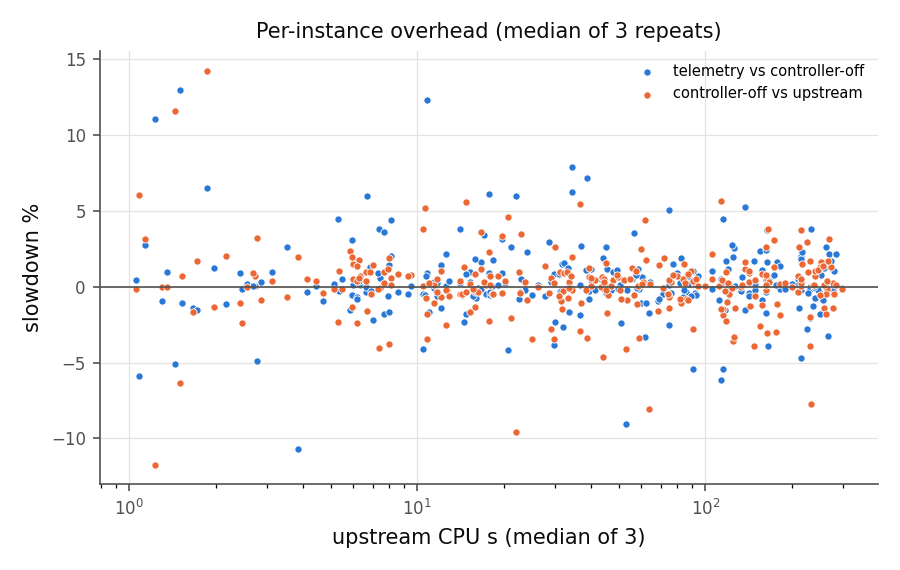

# M0–M1 报告：语义、正确性、观测与无操作对照

状态：M0 完成（2026-10-18）；M1 见第 4 节。表述分三类：**[源码]** 固定源码已证实；**[实验]** 本项目实验已观察；**[假说]** 待检验。

## 1. 环境与构建（M0）

| 项目 | 值 |
|---|---|
| CaDiCaL | `arminbiere/cadical@c60730422e758ef1cebe7aeddf2dda31c996bf04`，VERSION 3.0.1（子模块 `third_party/cadical`） |
| 证明检查 | `arminbiere/lrat-trim@b30f400f4ee5c32b77ee566a7c006081b521534f`（LRAT）；`marijnheule/drat-trim@2e3b2dc0ecf938addbd779d42877b6ed69d9a985`（备用，未用于主流程） |
| 编译环境 | gs-srun 容器 `genesis-v1_26.sqsh`（Ubuntu 22.04.5），g++ 13.4.0，`./configure -static` → `-Wall -Wextra -O3 -DNDEBUG -static` |
| 硬件 | AMD EPYC 9454（2×48 核，SMT2），1.5 TB 内存；Slurm `cpu-low` 独占节点，每节点 48 个求解进程绑定到间隔物理核 |
| 二进制 SHA-256 | upstream `57e2295d…`；fpc `6cf08469…`；upstream-check / fpc-check 见 `build/*/BUILDINFO` 与 `results/m0/m0_report.json` |
| 补丁 | `patches/cadical-fpc.patch`（SHA-256 `5e66834f…`）+ `solver/fpcontrol.{hpp,cpp}`；设计见 [docs/DESIGN.md](../docs/DESIGN.md) |

复现：`git submodule update --init && scripts/build_solver.sh && scripts/build_tools.sh`（在容器内），然后 `python3 tests/m0_suite.py --out results/m0`。

## 2. 源码复核（M0）

- **[源码]** `rg 'forcephase|likely_phase|opts\.phase'` 在固定版本中只命中 `decide.cpp`（126、137 行）、`rephase.cpp`（24、41、53 行）、`internal.cpp:147`、`collect.cpp`（`likely_phase`），与审计一致。
- **[源码，审计补充]** `decide_phase()` 另被 `warmup.cpp:323`、`walk.cpp:836`、`walk_full_occs.cpp:738`、`condition.cpp:201` 调用（为 walk/warmup/条件化确定初始赋值）。因此命令行 `forcephase` 也影响这些路径的初始方向；但 walk/warmup 只经 rephase 触发，而 forcephase 关闭 rephase。轨道 C 的有效值对一致覆盖这些路径；轨道 P 不覆盖。
- **[源码]** API `phase(lit)`（`phases.forced`）优先级高于 `forcephase`（`decide.cpp:134` 注释 “swapped with opts.forcephase case!”），`force_saved_phase`（仅在 `try_to_satisfy_formula_by_saved_phases` 中使用）更高。
- **[源码]** `Solver::set` 仅在 CONFIGURING 状态可用；控制器因此不使用它，而在 `Internal` 内维护有效值对，仅在自然 restart 之后修改。

## 3. 正确性与语义验证（M0）

`tests/m0_suite.py`（容器内，`results/m0/m0_report.json`）与 `tests/api_phase_test.cpp`。全部检查 **0 失败**。

| 检查 | 规模 | 结果 |
|---|---|---|
| A. 小公式 vs 独立参考 | 259 个公式（随机 2/3/4-SAT，n ≤ 16；PHP 2–5；随机 3 着色；空公式、空子句、根冲突、单元、全负可满足）；参考解 = Python DPLL，n ≤ 12 时再由穷举校验（0 不一致）。每个公式 × 8 个命令行配置 × upstream-check/fpc-check 两个**带断言**构建 + 12 个控制器配置 | 7,252 次运行，0 失败；5,460 个 SAT 模型经 `checkmodel` 校验，1,792 个 UNSAT 经 LRAT/lrat-trim 校验 |
| B. 切换应力 | 22 个中等公式（随机 3-SAT n=120–200、PHP 7/8、着色）× 4 静态 + 12 控制器（每次 restart 都切换的 schedule、随机切换、repeat 策略、轨道 C/P、`fpcrlim`），fpc-check 构建 | 352 次运行，0 失败，各配置答案一致；实际切换数最高 116 次/运行 |
| C. 搜索等价性 | 22 个中等公式 × 7 组对照 | 154 组比较全部相同（冲突、决策、传播、restart、rephase、reuse、stabilizing、learned 统计逐项相等） |
| D. 同 prefix 重放 | 22 个公式 × K∈{1e3,5e3,1e4} × 轨道 C/P，D 遥测运行 vs “在 K 切换”运行，各重复 2 次 | 32 个案例：检查点 digest 相同、切换发生在该检查点、重复运行最终 digest 相同、非计时特征逐项相同 |
| F. 选项真值表（决策计数） | 6 个公式 × 8 配置 | 全部符合：F−/固定 NEGATIVE 100% 负决策且来源 = forcephase、rephase 0 次；裸 `--forcephase` 与 F+ 0% 负决策；轨道 P 100% 负决策但来源仍为 target/saved 且 rephase 照常；S 纯 saved（来源仅 saved/fallback、无 target、无 rephase）；D、I− 来源为 target/saved |
| G. 退出强制时的 rephase | 8 个公式，schedule 往返 | 自然语义：3 次返回 NATIVE 时 rephase 限制均已过期，下一窗口立即发生 1 次 rephase；`--fpcrlim=1` 时 3 次都被推迟（下一窗口 0 次） |
| API 优先级 | 10 个用例（关闭 lucky/walk/预处理的平凡可满足公式） | 全部通过：默认/裸 forcephase 为正；`forcephase+phase=0` 为负；API 负相位优先于裸 forcephase；API 正相位优先于 forcephase 负、轨道 C 负、轨道 P 负 |

C 组的具体对照：upstream D vs fpc 控制器关闭；upstream D vs fpc telemetry；upstream F− vs 控制器固定 NEGATIVE；upstream I− vs 固定 NATIVE_INIT_NEG；upstream F+ vs 固定 POSITIVE；upstream F− vs fpc telemetry+F−；upstream D+LRAT vs fpc telemetry+LRAT。

**[实验] 结论**：
1. 默认 `phase=1`，裸 `--forcephase` 强制**正**方向；负分支必须写 `--forcephase=1 --phase=0`。
2. 控制器关闭与 telemetry-only 不改变搜索；固定动作在变量创建前生效，与对应命令行配置逐项等价。
3. 强制负决策不限制传播：F− 的模型中仍有正文字（API 测试中 40/80 变量为正，均由传播得到）。
4. 在线切换（任意频率、两个轨道、rephase 推迟消融）在带断言构建下未触发断言，且所有 UNSAT 答案有经检查的 LRAT 证明。
5. 确定性重放在相同检查点得到相同 digest，因此“同一状态继续两个动作”的标签可以通过重放获得。

另外在 smoke（20 个 train 实例 × 4 配置 × 10 s）中确认 runner、容器、证明、检查、日志压缩全流程可用；SIGTERM 超时会优雅结束并写出统计与遥测 final 记录。

## 4. M1：观测开销与无操作对照

实验 `configs/experiments/m1_overhead.json`：train+val 中 census D（seed 0）在 ≥1 s 内解出的 292 个实例；三个配置 × 3 次重复：未打补丁上游二进制（无遥测）、打补丁但控制器关闭、打补丁 telemetry-only（`--fpc=1`，窗口 1e4 冲突，检查点特征与 digest）；全部带 LRAT 证明输出（与所有正式实验一致），在与其他实验相同的并发条件下运行（每节点 48 进程）。分析：`scripts/analyze_m1.py`，完整表见 [m1/tables.md](m1/tables.md)。

**确定性（[实验]）**：289 个实例的全部 9 次运行都解出（另有 7 次运行在 300 s 边界超时，来自 3 个接近 cutoff 的实例）；冲突、决策、传播、restart、rephase 计数在上游 / 控制器关闭 / telemetry 以及重复之间**全部相同（0 个实例不同）**，答案无冲突。

**开销（每实例 3 次重复的中位数 CPU，基线 ≥1 s 的 288 例）**：

| 比较 | 中位 slowdown | p95 slowdown | 平均 | 总量 |
|---|---|---|---|---|
| telemetry vs 控制器关闭 | **0.08%** | 4.16% | 0.33% | 0.18% |
| 控制器关闭 vs 上游 | 0.16% | 3.27% | 0.08% | 0.03% |
| telemetry vs 上游 | 0.41% | 4.24% | 0.39% | 0.20% |
| 同一配置，重复 1 vs 0（噪声，带符号） | 0.03% | 5.77% | 0.07% | – |
| 同一配置，|重复 1 vs 0|（噪声幅度） | 1.19% | 8.81% | 2.45% | – |

求解器内部计时的控制器 hook 时间占运行 CPU 的比例：中位 0.010%，p95 0.071%，最大 0.166%。

**结论与未通过项**：
- 目标“telemetry-only median slowdown ≤ 1%”：**达到**（0.08%；对上游 0.41%）。
- 目标“p95 ≤ 3%”：**按配对计时未证明**（4.16%）。同一配置重复运行之间的 p95 差异（5.77%）大于该值，且 hook 实测时间 p95 只有 0.07%，因此 p95 超出主要来自 48 进程并发下的计时噪声，而不是遥测本身；我们披露此点，没有删除慢样本，也没有为此降低日志频率。
- 计时噪声对后续解读的含义：单次运行的 CPU 时间有约 ±1%（中位）到 ±9%（p95）的噪声；M5 用 3 个 seed 平均并以家族组 bootstrap 给区间。
- 所有正式实验都开启 telemetry，因此各配置承担相同的观测成本。

图：
