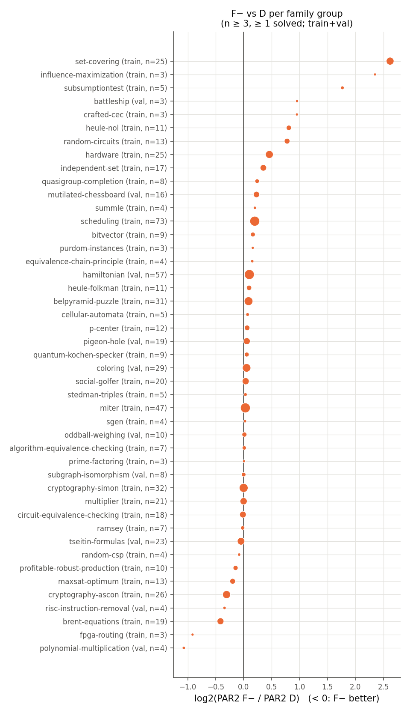
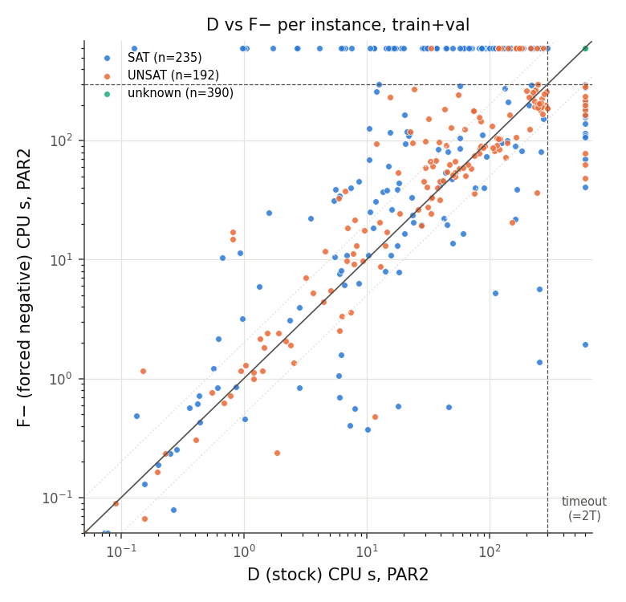
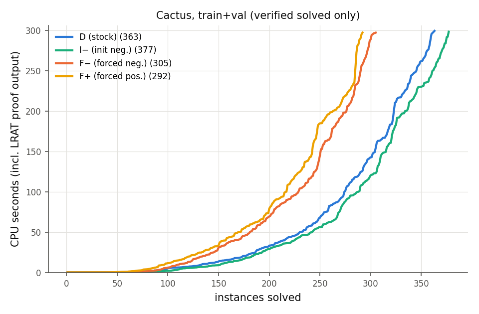

# M2 报告：静态互补性与机制诊断（开发集 train+val）

状态：完成（2026-10-18）。数据：train 612 例 / 67 个家族组，val 205 例 / 22 组；T = 300 s CPU；seed 0；所有配置统一输出二进制 LRAT 证明（计入时间），所有 solved 结果均已验证（SAT：`checkmodel`；UNSAT：lrat-trim）。**test 与 t2026 未运行。** 全部数字由 `scripts/analyze_m2.py` / `scripts/analyze_encoding.py` 从 `results/m2_census/runs.csv`、`results/m2_diag/runs.csv`、`results/m2_encoding/runs.csv` 生成，完整表见 [m2/tables.md](m2/tables.md) 与 [m2/encoding.md](m2/encoding.md)。

命令：`scripts/slurm_submit.sh configs/experiments/m2_census.json 6`（同理 `m2_diag`、`m2_encoding`），`scripts/collect.py`，`scripts/analyze_m2.py --runs results/m2_census/runs.csv --diag results/m2_diag/runs.csv --out reports/m2`。实际 compute 见 [COMPUTE_LEDGER.md](COMPUTE_LEDGER.md)。

## 1. 主要静态配置

| 配置 | 有效值对 / 选项 | solved（SAT/UNSAT） | 平均 PAR2 | 相对 D 的 PAR2 降低 [95% 家族 cluster CI] |
|---|---|---|---|---|
| D（stock） | (0,1) | 363（197/166） | 361.5 | — |
| I−（仅初始负） | (0,0) | **377**（208/169） | **351.9** | +2.7% [+0.3, +5.6] |
| F−（强制负） | (1,0) | 305（143/162） | 400.7 | −10.8% [−20.9, −4.3] |
| F+（强制正） | (1,1) | 292（125/167） | 409.3 | −13.2% [−26.4, −4.4] |

所有 3,268 次运行：1,337 solved、1,931 timeout，0 crash/memout/wrong/unverified；不同配置的 SAT/UNSAT 答案无冲突。

**[实验]** 在本数据（SAT Competition 2023–2025 主赛道，≤100 MB，300 s）上：
1. 强制负分支整体明显劣于原生策略，损失集中在可满足实例（SAT：143 vs 197），不可满足实例接近持平（162 vs 166）。
2. 强制正分支几乎同样差：损失主要来自“强制 + 关闭 rephase”，而不是“负”这个方向本身。
3. 只把初始相位设为负（保留 target / rephase）在 dev 上略优于 stock default，且 **I− 是按预注册规则选出的 validation-SBS**（val PAR2：I− 401.1、D 415.4、F+ 419.0、F− 432.2）。最终主比较对象因此是 I−；另报 D。

## 2. 互补性与 oracle 差距（诊断，使用未来信息）

| 范围 | 组合 | SBS | PAR2 SBS → VBS | 差距 [95% CI] | solved SBS → VBS |
|---|---|---|---|---|---|
| train+val | D, F− | D | 361.5 → 343.5 | 5.0% [2.5, 8.0] | 363 → 388 |
| train+val | D, I−, F−, F+ | I− | 351.9 → 321.5 | 8.6% [4.7, 13.6] | 377 → 417 |
| val | D, F− | D | 415.4 → 390.0 | 6.1% [1.4, 12.4] | 72 → 82 |

D 与 F− 互有胜负：F− 更快 151 例（≥2× 更快 57 例），更慢 234 例（≥2× 更慢 142 例），429 例双方超时；只有 F− 解出 25 例，只有 D 解出 83 例。

**[实验]** D/F− 的静态互补空间存在但不大：理想 oracle 比 D 低 5%，比 I− 只低约 2.4%（343.5 vs 351.9）。若要在部署时相对 I− 获得 ≥5% 收益，仅在 {D, F−} 间做实例级静态选择在 oracle 意义下也达不到；这在 M3 前就说明预设的实用目标很难达成。

## 3. 家族结构

- F− 明显占优（log2 比 < −0.3，n ≥ 3）：polynomial-multiplication（val, 4）、fpga-routing（3）、brent-equations（19）、cryptography-ascon（26，F− 多解 4 例）、risc-instruction-removal（val, 4）。
- F− 明显劣势：set-covering（25 例中 D 解 23、F− 解 5）、heule-nol（5 vs 0）、random-circuits、hardware（18 vs 15）、independent-set（7 vs 3）、scheduling（30 vs 23）、influence-maximization、pythagorean-triples 等。
- 多数大家族（miter、cryptography-simon、multiplier、hamiltonian、coloring、tseitin）差异小或双方大量超时。图着色（文献 R9 的动机家族）在本数据的 `coloring` 组（val, 29 例）中 F− 并不占优（D 4 解，F− 3 解）。

 

## 4. 机制诊断（RQ4）

| 配置 | 含义 | SAT solved | UNSAT solved | PAR2 |
|---|---|---|---|---|
| D | stock：target + rephase，正初始 | 197 | 166 | 361.5 |
| D/no-R | 仅关 rephase | 136 | 177 | 397.6 |
| I−/no-R | 负初始、关 rephase（F− 的 rephase 匹配对照） | 153 | 176 | 386.2 |
| S | 纯 saved（无 target、无 rephase，负 fallback） | 135 | **184** | 394.2 |
| F− | 强制负（同时关 rephase） | 143 | 162 | 400.7 |
| P− | 轨道 P：仅自由决策强制负，rephase/target 保留 | 145 | 157 | 403.4 |

（观察到的答案按任一配置的已验证结果分层：SAT 235，UNSAT 192，全部配置均未解 390。）

**[实验]** 分解：
1. **关闭 rephase 是 SAT 损失的主因**：D → D/no-R 少解 61 个 SAT，但多解 11 个 UNSAT。
2. **在同样关闭 rephase 的条件下，强制方向比使用 saved 相位更差**：F− 比 I−/no-R 少解 10 个 SAT、14 个 UNSAT。
3. **仅强制决策方向而保留 rephase（P−）同样差**（SAT 145、UNSAT 157）：被强制的决策不再读取 rephase 写入的 saved/target，rephase 的作用实际失效；P− 在 UNSAT 上甚至更差，可能因为它仍执行 rephase/walk 的成本却得不到收益（[假说]）。
4. **UNSAT 上“不 rephase、用 saved”最好**（S 184、D/no-R 177 vs D 166）：stock 默认的 rephase 调度对 UNSAT 有净成本（[实验]，本数据与 cutoff 下）。这与 forcephase 的 UNSAT 表现无关：F− 并未获得这部分收益。

因此“F− 的好坏”不能归因于“负方向”：它是“关闭 rephase”（对 SAT 大负面、对 UNSAT 小正面）与“忽略 saved/target 相位”（对两类都负面）的组合；只有少数家族（见第 3 节）在组合后仍净受益。

## 5. 编码敏感性（H1）

（`m2_encoding` 完成后由 `scripts/analyze_encoding.py` 生成 [m2/encoding.md](m2/encoding.md)，结论在此补充。）

## 6. 结论、未通过项与下一步

- RQ1（互补性）：D/F− 的实例级互补存在（oracle 5%），集中在少数家族；F− 整体劣势显著，且在 SAT 上更明显。
- 预设门槛（SBS–VBS < 2% 时先做机制分析）未触发；但 oracle 相对 validation-SBS（I−）只有约 2.4%，相对 I− 达到 5% 的实用目标在静态意义下不可能，M3/M4 主要回答“能否预测、在线信息是否有用”。
- 新增次要变体（开发集决定，见 EXPERIMENT_LOG 20:25）：I− prefix → NEGATIVE（NATIVE_INIT_NEG，phase 固定 0 只切 forcephase），与 D prefix 结果分开报告。
- 局限：单一 cutoff 300 s；seed 0；family 组是保守别名 + isohash 合并，部分 GBD 家族本身较粗（如 `hardware`、`cryptography`）。
