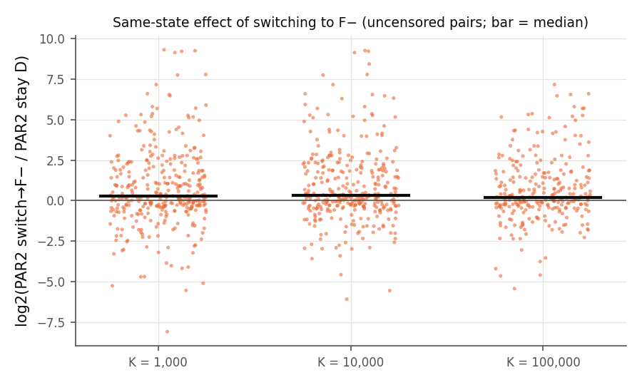

# M3 报告：可解释的一次选择（开发集）

状态：完成（2026-10-18）。只使用 train+val（817 例，89 个家族组）；**test 与 t2026 未运行**。所有数字由脚本从运行记录生成：`scripts/m3_build.py`（数据集）、`scripts/m3_train.py`（选择器）、`scripts/analyze_rq3.py`（时间变化）、`scripts/m3_feature_signal.py`（单变量信号）；完整表见 [m3/tables.md](m3/tables.md)、[m3/rq3.md](m3/rq3.md)、[m3/feature_signal.md](m3/feature_signal.md)。

## 1. 设置

**同状态标签（确定性 prefix 重放）**。对每个实例和 K ∈ {1e3, 1e4, 1e5}：
- “保持”分支 = census 中的 D 运行（遥测开启，从头 NATIVE）；
- “切换”分支 = `sw{K}_C`：同样从头 NATIVE，在第一个冲突数 ≥ K 的自然 restart 处切到 NEGATIVE（轨道 C）并保持到结束；
- 两个分支都是从进程启动开始、总预算 T = 300 s 的完整运行（prefix 计入时间）；
- 用检查点 digest 验证两分支在决策点的状态相同：**4,233 个重放中 4,230 个 digest 一致**；其余 3 个在 1e5 处因计时波动未在 300 s 内到达检查点（双方都 timeout，标签删失，成本相同）。
- 同样构造了 I− prefix → NEGATIVE（`sw{K}_Cin`，NATIVE_INIT_NEG 变体）、F− prefix → NATIVE @1e4（`sw10k_Crev`，反向）以及轨道 P @1e4（`sw10k_P`）。
- 实例在 K 之前已解出则没有决策点（D prefix：1e3 时 48 例、1e5 时 119 例），该实例的部署成本就是基础运行成本。

**选择器**（全部在 dev 上用家族分组的 5 折嵌套交叉验证评估：外层 5 折给出 out-of-fold 决策，内层 4 折在每个外层训练集上选择超参数）：
- 模型族：决策树（深度 1–3，叶子最少 10/30 例）与 L2 logistic（C = 0.1/1）；
- 代价敏感学习：标签“切换更便宜”，权重 = |两分支 PAR2 差|，双 timeout 权重为 0；
- 特征组：C 静态（解析时计数）、R 进度/原生机制、P 极性与分歧、Q 学习质量、T 搜索形态（定义见 [docs/DESIGN.md](../docs/DESIGN.md) §5）；time-only = {CPU 时间, log 冲突数, 当前模式}；
- 静态选择器：`tools/cnffeatures` 的同名静态特征（CPU 时间计入部署成本），在开始前选 D 或 F−（另有 I−/F− 版本）；
- 对照：打乱训练标签（shuffled labels），在同样流程下评估。

## 2. 结果：没有可部署选择器优于“不切换”

out-of-fold 平均 PAR2（dev 817 例；括号为相对 D 与相对 I− 的降低，95% 家族组 cluster bootstrap；正数更好）：

| 选择器 | PAR2 | solved | 相对 D | 相对 I−（validation-SBS） |
|---|---|---|---|---|
| D（永不切换） | 361.5 | 363 | — | −2.7% [−6.0, −0.4] |
| **I−**（validation-SBS） | **351.9** | **377** | +2.7% [+0.4, +5.6] | — |
| F−（从头强制负） | 400.7 | 305 | −10.8% | −13.9% |
| 静态选择器 D/F−（cnffeatures） | 364.2 | 360 | −0.7% [−2.4, +0.2] | −3.5% |
| 静态选择器 I−/F− | 360.9 | 364 | +0.2% | −2.6% |
| 一次选择 @1e3 [time-only] | 361.3 | 364 | +0.1% [−0.7, +0.9] | −2.7% |
| 一次选择 @1e3 [C+R] | 364.6 | 360 | −0.8% | −3.6% |
| 一次选择 @1e3 [C+R+P] | 370.9 | 350 | −2.6% [−5.2, −0.5] | −5.4% |
| 一次选择 @1e3 [all] | 369.6 | 351 | −2.2% [−4.4, −0.3] | −5.0% |
| 一次选择 @1e4 [all] | 368.1 | 353 | −1.8% | −4.6% |
| 一次选择 @1e5 [all] | 365.6 | 358 | −1.1% | −3.9% |
| I− prefix 一次选择 @1e3 [all] | 356.2 | 371 | +1.5% | −1.2% |
| I− prefix 一次选择 @1e4 [time-only] | 351.9 | 377 | +2.7% | 0.0%（从不切换） |
| 总是在 1e3 切到 F− | 396.2 | 311 | −9.6% | −12.6% |
| *oracle* 静态 D/F− | 343.5 | 388 | +5.0% | +2.4% |
| *oracle* 一次选择 @1e3（D prefix） | 342.3 | 389 | +5.3% | +2.7% |
| *oracle* 一次选择 @1e3（I− prefix） | 335.1 | 403 | +7.3% | +4.8% |

（oracle 使用未来信息，只作诊断。完整 6 个特征组 × 3 个 K × 2 种 prefix 及其 shuffled-label 对照见 [m3/tables.md](m3/tables.md)。）

**[实验] 结论**：
1. **RQ2 的回答是否定的**：在未见家族上，静态特征、time-only 或包含在线内容统计的一次选择器都没有超过“从不切换”；加入 P/Q/T 组的在线模型反而比不切换差 1–3.5%，与 shuffled-label 对照处在同一水平。cost-weighted AUC 在 0.3–0.65 之间，没有稳定区分能力。
2. **在线观测没有超过静态/时间基线**（按目标文件的要求“先证明在线观测超过静态/时间基线”）：未通过。
3. 部署时选择器退化为“从不切换”（time-only 模型的叶子都 < 0.5），因此冻结导出的 M3 策略等价于 D 或 I−；它们只作为 M5 的次要报告项。
4. **同状态切换的潜在收益存在但集中**：oracle 一次选择比 D 低约 5%，但真实收益只出现在 342 个未删失决策点中的 143 个（@1e3），而且无法从家族外预测。

## 3. 为什么预测失败（描述性）

[m3/feature_signal.md](m3/feature_signal.md)：
- 在 1e3/1e4/1e5，最强的单变量 Spearman 相关只有 |ρ| ≈ 0.2–0.27（如反 Horn 比例、负决策比例、target 来源比例、Horn 比例），**扣除家族组均值后几乎为 0**（|ρ_within| ≲ 0.1，最多 0.25）。信号主要是家族之间的差异，家族不相交的模型无法利用。
- 方向也与直觉相反：原生 prefix 中负决策比例越高，切到 F− 越**不**利（ρ ≈ +0.21），不支持“原生已偏向负方向就该强制负”的 H2 版本。
- 事后按答案分层：SAT 实例上切换更好的只有 32–36%，中位数使 PAR2 翻倍；UNSAT 上切换更好的比例为 47–49%，中位效应约为 0。也就是说，UNSAT 上的动作选择接近抛硬币，SAT 上大多不该切。部署时 SAT/UNSAT 未知，这是可预测性的根本限制之一（[假说]）。

## 4. RQ3：动作偏好是否随时间变化（同状态证据）

[m3/rq3.md](m3/rq3.md)：

| 同一实例在 K = 1e3/1e4/1e5 的偏好模式 | 实例数 |
|---|---|
| NAT/NAT/NAT | 135 |
| NEG/NEG/NEG | 78 |
| 偏好改变（6 种模式合计） | 56（21%） |

- 在三个 K 都有未删失偏好的 269 例中，79% 偏好不变，21% 随时间改变。
- 反向：从 F− prefix 在 1e4 切回 NATIVE，在 745 个决策点中 228 例更便宜、101 例更贵；“F−→D@1e4”这一**无观测固定调度**在 dev 上 PAR2 349.2、解出 382，优于 D（361.5 / 363）且略优于 I−（351.9 / 377）。
- 按切换时机的 oracle：D prefix 最佳单次切换时间比 D 低 7.5%（静态 oracle 5.0%）；再加入反向方向，oracle 比 D 低 11.4%、比 I− 低 9.0%。时机确实影响结果，但 M3 显示在线特征无法预测它。

## 5. 门槛判断与下一步

- M3 → M4 的证据门槛（“在线观测有可迁移价值，或同状态实验显示动作偏好随搜索变化”）：前者**未满足**；后者**部分满足**（21% 实例偏好改变、反向固定调度有收益）。
- 决定（记录于 EXPERIMENT_LOG 2026-10-18 22:15，先于 M4 运行）：不实现基于特征的重复切换控制器；只评估一小组预先固定的**无观测固定调度**（F−→D、F−→I− 在三个 K；rephase 推迟消融；按模式调度），并按预注册规则从所有 dev 评估过的可部署策略中选出 M5 唯一主要候选。
- 本阶段 compute：重放 5,887 次运行（见 [COMPUTE_LEDGER.md](COMPUTE_LEDGER.md)）；模型训练约 1 分钟 CPU。
