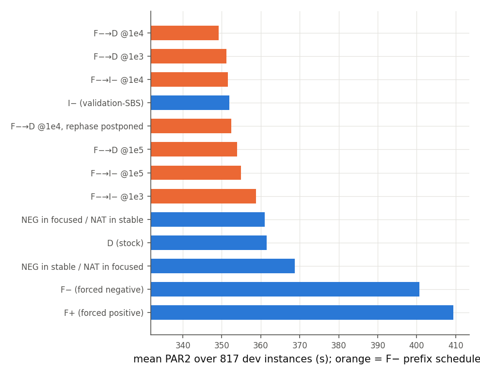
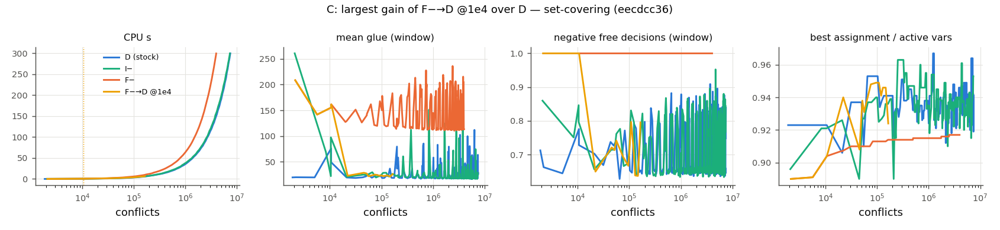

# M4 报告：门槛判断与无观测固定调度（开发集）

状态：完成（2026-10-18）。dev = train+val 817 例，seed 0，T = 300 s；**test 与 t2026 未运行**。分析：`scripts/analyze_m4.py`，完整表 [m4/tables.md](m4/tables.md)。

## 1. 门槛判断（记录于 EXPERIMENT_LOG 2026-10-18 22:15，先于本阶段运行）

- 目标文件要求 M4 在“证据支持时”才做重复选择。M3 显示在线特征在家族外**没有**可迁移的预测价值（所有在线选择器都不优于不切换，与 shuffled-label 对照相当），所以**没有实现基于特征的重复切换控制器**，也没有尝试 bandit/RL：它们只会依赖已被证伪的同一组观测。
- 但同状态重放（RQ3）显示动作时序本身有价值：21% 的实例偏好随 K 改变，按切换时机的 oracle 超过静态 oracle，反向调度 F−→D@1e4 在 dev 上优于 D。因此评估了一个小的、预先固定的**无观测固定调度**集合（8 个新配置，不再扩展），以回答“时序本身是否可部署地带来收益”，并按预注册规则选出 M5 的唯一主要候选。

## 2. 结果

相对 PAR2 降低（正数为更好），95% 家族组 cluster bootstrap：

| 策略 | PAR2 | solved（SAT/UNSAT） | 相对 D | 相对 I− |
|---|---|---|---|---|
| D（stock） | 361.5 | 363（197/166） | — | −2.7% [−6.0, −0.3] |
| I−（validation-SBS） | 351.9 | 377（208/169） | +2.7% [+0.3, +5.6] | — |
| F− | 400.7 | 305（143/162） | −10.8% | −13.9% |
| **F−→D @1e4** | **349.2** | **382（210/172）** | **+3.4% [+0.9, +6.6]** | +0.8% [−0.7, +2.2] |
| F−→D @1e3 | 351.1 | 380（206/174） | +2.9% [+0.3, +6.2] | +0.2% [−2.1, +2.3] |
| F−→D @1e5 | 353.9 | 375（201/174） | +2.1% [+0.2, +4.3] | −0.6% [−2.9, +1.3] |
| F−→I− @1e3 | 358.8 | 369（196/173） | +0.8% | −1.9% |
| F−→I− @1e4 | 351.6 | 380（207/173） | +2.8% [+0.3, +5.6] | +0.1% [−1.8, +2.0] |
| F−→I− @1e5 | 354.9 | 375（202/173） | +1.8% | −0.9% |
| F−→D @1e4，返回时推迟 rephase | 352.4 | 379（208/171） | +2.5% [+0.8, +4.9] | −0.1% |
| focused 时 NEG / stable 时 NAT | 361.0 | 368（210/158） | +0.2% | −2.6% |
| stable 时 NEG / focused 时 NAT | 368.8 | 354（183/171） | −2.0% | −4.8% |
| D→F− @1e4（M3 重放，对照方向） | 398.8 | 306 | −10.3% | −13.3% |

train / val 分开看（PAR2）：F−→D@1e4 在 train 333.5（I− 335.4，D 343.5），在 val 396.2（I− 401.1，D 415.4）；val 上最好的是 F−→D@1e3（389.5）。

## 3. 解释

**[实验]**
1. **“先短暂强制负分支，再回到原生策略”在 dev 上稳定优于 stock default**：三个切换时刻都比 D 好 2.1–3.4%，CI 都不含 0；SAT 和 UNSAT 都多解（F−→D@1e4：+13 SAT、+6 UNSAT）。
2. **但它与“仅把初始相位设为负”（I−）无法区分**：相对 I− 的差在 −0.6% 到 +0.8% 之间，CI 都跨 0。最直接的解释（[假说]）是：两者都让早期搜索在“负”方向上进行，并在之后保留原生的 target/rephase 机制；强制负 prefix 额外贡献的学习子句与变量活性没有显著的附加价值。
3. **返回原生时的 rephase 语义**：主语义下返回 NATIVE 后立即发生一次过期的 rephase（第一种类型为 original，即把 saved 全部设为正）；把它推迟（`fpcrlim`）不带来改善（352.4 vs 349.2）。返回 I− 对（saved 设为负）也不比返回 D 好。也就是说，负 prefix 的收益并不依赖于把负的 saved 相位延续下去。
4. **只按模式调度**（focused/stable）不优于 D：在 focused 时强制负会多解 SAT（210 vs 197）但少解 UNSAT（158 vs 166），在 stable 时强制负则 SAT 明显变差（183）。这与 M2 的机制一致：stable 模式中的 target/rephase 对 SAT 最重要。
5. 反方向（先原生再强制负）大幅变差，说明“何时用负分支”的答案在这个数据上是：**只在最开始短暂地用**，之后交还原生策略；长时间强制负总体有害。

**代表性轨迹**（规则见 `scripts/plot_trajectories.py`，[trajectories](trajectories/trajectories.md)）：
- C：F−→D@1e4 相对 D 收益最大——set-covering（SAT）：D、I−、F− 都超时，F−→D@1e4 在约 2×10⁵ 冲突、6.9 s 解出。F− 阶段的窗口平均 glue 很高（>100，D/I− 约 20–50），best 赋值比例更低；切回原生后 glue 立即回落。
- D：F−→D@1e4 相对 I− 损失最大——hamiltonian（val，SAT）：I− 4.7 s，F− 296.5 s，F−→D@1e4 与 D 超时。
这两个相反的例子都出现在可满足实例上，提示负 prefix 的作用很大程度上是改变早期搜索路径（多样化），其效果在单个 SAT 实例上高度依赖路径（[假说]）。

## 4. M5 主要候选（预注册规则）

规则：在所有在 dev 上评估过的可部署非静态策略（M3 out-of-fold 选择器、M4 固定调度）中取 dev 平均 PAR2 最低者。结果：**F−→D @1e4**（配置 `sw10k_Crev`：变量创建前设为 NEGATIVE=(1,0)，在第一个冲突数 ≥ 10,000 的自然 restart 处切换到 NATIVE=(0,1)，之后不再切换；不使用任何观测）。

预期（基于 dev，**不是**结论）：相对 stock D 可能有约 3% 的改进；相对 validation-SBS I− 的预设 ≥5% 目标在 dev 上远未达到（+0.8%），预计 held-out 上也达不到。按协议，主假设只对这个冻结候选检验，其余列为次要比较。
