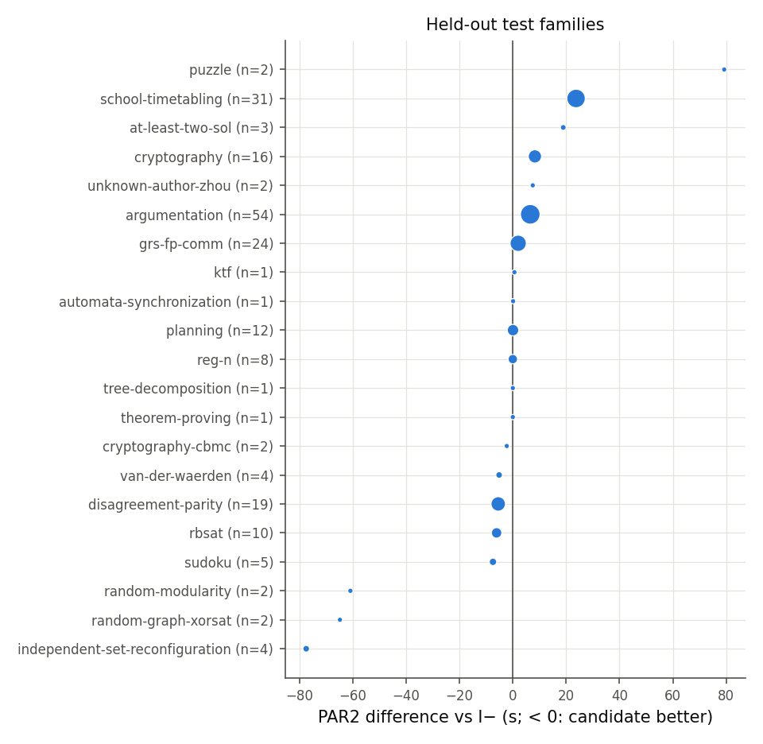
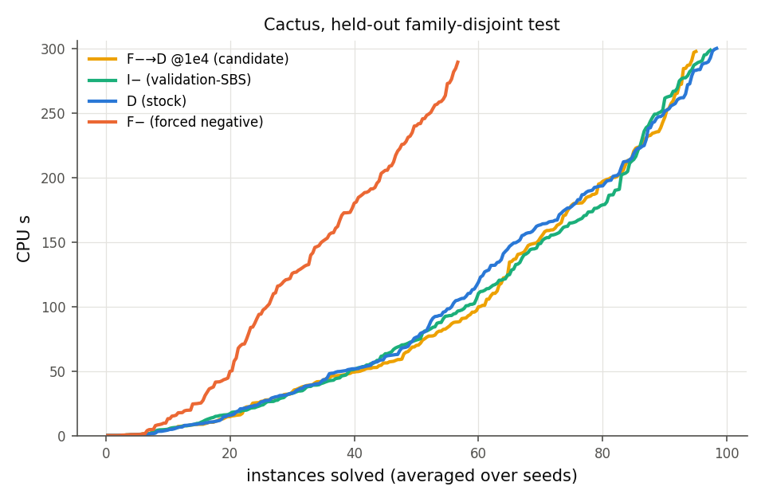

# M5 报告：冻结后的 held-out 评估

状态：完成（2026-10-19）。冻结点：git tag `m5-freeze`（提交 74e4437，2026-10-18 23:31 UTC），在任何 test / t2026 求解器运行之前提交；评估脚本、冻结文件、策略文件与 held-out 实验定义在评估时与该 tag 逐字节相同（`git diff m5-freeze` 为空），之后只修改了 `scripts/m5_eval.py` 中两幅图的配色与坐标标签（数值输出不变）。完整表：[m5/tables.md](m5/tables.md)；事后分层：[m5/posthoc.md](m5/posthoc.md)。

命令：

```bash
scripts/slurm_submit.sh configs/experiments/m5_heldout.json 10      # 13,716 次运行
scripts/run_static_features.py --splits test,t2026 --out results/static_features_heldout.csv
scripts/collect.py --exp configs/experiments/m5_heldout.json --out results/m5_heldout/runs.csv
$FP_PY scripts/m5_eval.py --freeze configs/m5_freeze.json --runs results/m5_heldout/runs.csv \
    --static results/static_features_heldout.csv --out reports/m5
$FP_PY scripts/m5_posthoc.py --runs results/m5_heldout/runs.csv --out reports/m5/posthoc.md
```

## 1. 设置

- **数据**：family-disjoint test（204 例，21 个家族组，从未用于任何选择）；年份外推 t2026（304 例，78 组；seen 107、devtest 49、new 148）。
- **seed**：0（原 CNF）、1、2（变量置换 + 子句/文字打乱，保持符号）；每个实例先对 3 个 seed 平均 PAR2。
- **配置**（全部真实运行，T = 300 s CPU，LRAT 证明，遥测）：D、I−、F−、F+、候选 F−→D @1e4、F−→D @1e3/@1e5、D→F− @1e4、M3 一次选择器（time-only，@1e3）。派生：静态选择器 D/F−（`cnffeatures` 时间计入）、随机切换时机（每个 (实例, seed) 在 F−→D @1e3/@1e4/@1e5 中均匀选一个；同样一次切换的预算）。
- **验证**：13,716 次运行，3,942 solved（全部验证通过：SAT 模型检查、UNSAT LRAT 检查），9,774 timeout；0 crash、0 memout、0 wrong、0 unverified；同一 (实例, seed) 无冲突答案。

## 2. 主假设（family-disjoint test）

**预注册主假设**：候选 F−→D @1e4 相对 validation-SBS（I−）的 mean PAR2 降低 ≥ 5%，95% 家族组 cluster bootstrap CI 不含 0，且每 seed 平均 solved 不低于 I−。

| 策略 | PAR2 | solved（seed 0/1/2） | 平均 solved | 相对 I− | 相对 D |
|---|---|---|---|---|---|
| **F−→D @1e4（候选）** | 363.8 | 99 / 90 / 96 | 95.0 | **−1.0% [−3.4, +1.7]** | −0.9% [−4.8, +2.1] |
| I−（validation-SBS） | 360.3 | 102 / 94 / 96 | 97.3 | — | +0.1% [−4.9, +4.3] |
| D（stock） | 360.5 | 102 / 99 / 94 | 98.3 | −0.1% | — |
| F− | 465.6 | 49 / 61 / 60 | 56.7 | −29.2% [−70.4, −9.7] | −29.2% [−65.2, −10.8] |
| F+ | 433.1 | 71 / 71 / 68 | 70.0 | −20.2% | −20.2% |
| 静态选择器 D/F− | 361.0 | 102 / 98 / 94 | 98.0 | −0.2% | −0.1% |
| F−→D @1e3 | 357.9 | 102 / 94 / 99 | 98.3 | +0.7% [−3.3, +4.7] | +0.7% [−0.9, +2.1] |
| F−→D @1e5 | 379.8 | 95 / 84 / 91 | 90.0 | −5.4% [−11.4, −0.5] | −5.4% [−9.1, −2.3] |
| D→F− @1e4 | 458.2 | 58 / 63 / 58 | 59.7 | −27.2% | −27.1% |
| M3 一次选择器（time-only） | 369.5 | 100 / 90 / 92 | 94.0 | −2.5% | −2.5% [−5.7, −0.3] |
| 随机切换时机 | 365.6 | 97 / 90 / 99 | 95.3 | −1.5% | −1.4% |

**结论：主假设不成立。** 候选没有达到 5% 目标，点估计反而略差于 I−（−1.0%，CI 跨 0），平均 solved 少 2.3 个。在 (实例, seed) 层面，候选相对 I− 新解出 15 个、丢失 22 个；最大的单实例回退来自 van-der-waerden（+325 s）、school-timetabling（+235 s、+179 s）、cryptography（+191 s）、rbsat（+175 s）。dev 上的 +0.8%（相对 I−）与 +3.4%（相对 D）都没有在 test 上复现。

 

家族层面（PAR2 差，候选 − I−）：school-timetabling（31 例）和 argumentation（54 例）上候选更差，independent-set-reconfiguration、random-graph-xorsat、random-modularity 上更好，但都是小家族；没有一个大家族显示系统性收益。

## 3. 年份外推 t2026（次要）

| 子集 | 候选 PAR2 | I− PAR2 | D PAR2 | 候选 vs I− | 候选 vs D | I− vs D |
|---|---|---|---|---|---|---|
| 全部 304 例 | 490.8 | 487.4 | 497.0 | −0.7% [−2.0, +0.4] | +1.3% [+0.2, +2.5] | +1.9% [+0.7, +3.5] |
| seen 家族（107） | 495.3 | 497.6 | 499.9 | +0.5% | +0.9% | +0.5% |
| dev-test 家族（49） | 448.8 | 449.4 | 458.6 | +0.1% | +2.1% | +2.0% |
| 新家族（148） | 501.4 | 492.6 | 507.7 | −1.8% [−3.6, −0.6] | +1.2% | +3.0% [+1.2, +5.5] |

在 2026 年实例上，候选与 I− 都略优于 stock D（候选 +1.3%、I− +1.9%，CI 不含 0），但候选不优于 I−（新家族上还显著差 1.8%）。其它方案：F−→D @1e3 +1.6%、@1e5 +1.5%、随机切换时机 +1.4%（均相对 D）；F− −0.1%、F+ −1.2%、M3 选择器 −0.2%。

## 4. 事后分层（描述性，[m5/posthoc.md](m5/posthoc.md)）

| test | SAT（82 例）平均 solved | UNSAT（52 例）平均 solved |
|---|---|---|
| 候选 F−→D @1e4 | 58.0 | 37.0 |
| I− | 59.0 | 38.3 |
| D | 60.0 | 38.3 |
| F− | 25.3 | 31.3 |
| F+ | 29.3 | **40.7** |

- F− 的损失仍集中在 SAT（25 vs 60），与 dev 一致。
- 意外但与 M2 机制一致的观察（[实验]，探索性）：**强制正（F+）在 UNSAT 上是最好的配置**——test UNSAT 40.7 vs D 38.3（PAR2 238 vs 265），t2026 UNSAT 30.7 vs 26.0（PAR2 164 vs 225）。M2 中“关闭 rephase、固定方向”对 UNSAT 有利（S 纯 saved 在 dev UNSAT 上最好），F+ 同样关闭 rephase。由于 SAT/UNSAT 在部署时未知且 F+ 在 SAT 上大幅变差，这不构成可部署的策略；它是一个需要独立验证的假说（“在已知或预测为 UNSAT 时禁用 rephase”）。

## 5. 其它基线与对照的解读

- **静态选择器**：冻结的 D/F− 静态模型在全部 1,524 个 (实例, seed) 上都选择 D（它在 dev 上已退化），表现等于 D 加特征时间。
- **M3 一次在线选择器**（time-only logit，@1e3）在 test 上比 D 差 2.5%（CI 不含 0）。它的输入包含 CPU 时间，因此部署决策会受计时噪声影响；在 dev 的 out-of-fold 评估中它约等于 D。
- **随机切换时机**与候选无显著差异（−1.5% vs I−），说明“在哪个 K 切回”在 test 上也不是关键因素；F−→D @1e5 显著更差（负 prefix 太长）。
- **D→F− @1e4**（先原生后强制负）与 F− 一样差：在 test 上同样确认“后期强制负”有害。

## 6. 结论

1. 预设的实用正结果目标**未达成**：冻结候选相对 validation-SBS 没有改进（−1.0% [−3.4, +1.7]），solved 略少。
2. 稳健的 held-out 结论是负面与限定性的：强制负分支在 family-disjoint test 上比 stock default 差 29%（主要在 SAT 上）；“开始时短暂强制负再交还原生策略”与 stock default、仅初始负都无法区分（family-disjoint test），在 2026 年实例上比 stock default 好约 1–2%，但不比仅初始负更好。
3. dev 上观察到的 F−→D 调度相对 D 的 +3.4% 在 test 上消失，说明 dev 上的选择（在 9 个调度中取最优）有乐观偏差，也说明这类小效应对家族组成敏感。

## 7. Audit v2 复核（2026-10-19）

`scripts/audit_v2/m5_recheck.py` 不复用 `m5_eval.py`，直接从 13,716 个原始 JSON 运行记录独立重算：覆盖完整（0 缺失、0 重复），所有 solved 均验证通过；每个 seed 的 solved 数完全一致，PAR2 与相对差的点估计差 ≤ 1.4e−6，独立 bootstrap 区间与本报告相差 ≤ 0.26 个百分点；冻结提交（23:31:04Z）早于第一条 M5 运行（23:31:45Z）。全账本完整性审计对 M5 的 13,716 次运行未发现问题。候选是无观测固定调度、M3 选择器只用 time-only 特征，均不依赖审计中发现失效的 `x_saved_flip_frac`，因此本报告结果保持不变（[audit_v2/m5_recheck.md](audit_v2/m5_recheck.md)）。

