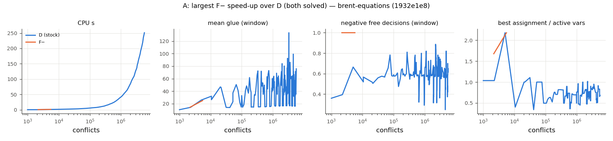
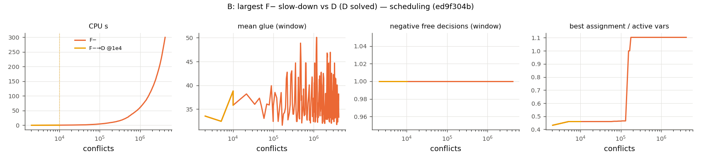
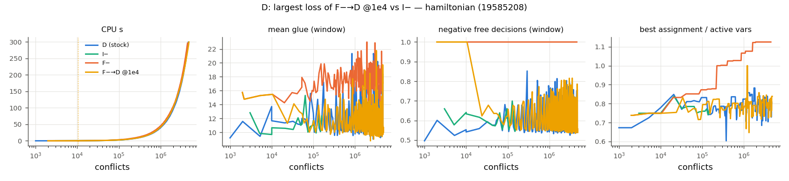

# Trajectory explanations (generated by scripts/plot_trajectories.py)

Selection rules are fixed in the script; values are PAR2 seconds (600 = timeout).

## A: largest F− speed-up over D (both solved) — `1932e1e8f0c7` (brent-equations, train, GBD result sat)

| config | PAR2 |
|---|---|
| D (stock) | 257.8 |
| I− | 0.3 |
| F− | 1.4 |
| F−→D @1e4 | 1.4 |

## B: largest F− slow-down vs D (D solved) — `ed9f304b537a` (scheduling, train, GBD result sat)

| config | PAR2 |
|---|---|
| D (stock) | 0.1 |
| I− | 0.1 |
| F− | 600.0 |
| F−→D @1e4 | 0.9 |

## C: largest gain of F−→D @1e4 over D — `eecdcc36d35f` (set-covering, train, GBD result sat)

| config | PAR2 |
|---|---|
| D (stock) | 600.0 |
| I− | 600.0 |
| F− | 600.0 |
| F−→D @1e4 | 6.9 |

## D: largest loss of F−→D @1e4 vs I− — `195852083a05` (hamiltonian, val, GBD result sat)

| config | PAR2 |
|---|---|
| D (stock) | 600.0 |
| I− | 4.7 |
| F− | 296.5 |
| F−→D @1e4 | 600.0 |

