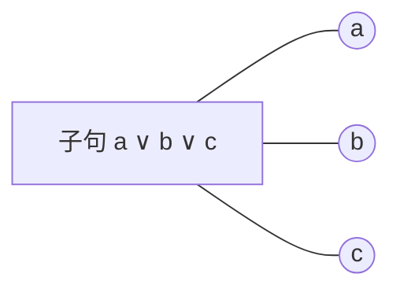
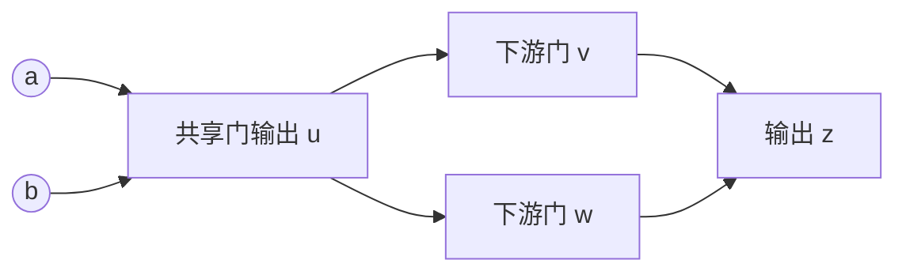

# Phase选择特征：结构、长度与动作前搜索统计

日期：2026-11-04，America/New_York。用途：解释、文献对照与候选特征定义；未运行新提取、拟合或solver实验，未修改在途任务、冻结提案、特征白名单或测试划分。

## 用户澄清与目标

本聊天用户确认，先前的“deck like”应为 **DAG-like**；“Longer clause, more like the lie”应理解为 **longer clauses, more likely F−**。这解决了旧交接中“deck-like含义未明确”的术语问题。长子句偏F−仍是待检验的方向假设，不是已经成立的规则。

目标是由可观测数值预测D/F+/F−的净成本；结构画像、学习子句质量与phase选择收益是不同问题。其他solver使用某项统计，不自动证明它能选择phase。当前phase_prediction_v1禁止family/应用/身份/真实答案特征或抽样分层；本笔记只讨论由CNF及动作前状态计算的量。

## 1. Tree-like：明确图表示

优先使用变量—子句二分图：变量和子句为两类节点，同一变量在同一子句中出现即连一条边，重复文字不重复加边。令V为节点数、E为边数、c为连通分量数，cycle excess为 `E−V+c`。值为0表示森林；归一化值、叶变量比例与分量规模描述接近森林的程度，不等于精确treewidth。

现有数值：`g_cycle_excess_per_incidence`、`g_leaf_variable_fraction`、`g_largest_component_fraction`、变量度分布及`g_degree_two_fraction`。单个值不足以识别完整结构；例如星状图也有许多叶节点。

不能将“图像树”与“搜索树形状”“tree-like resolution proof”“低treewidth”混为一类。本项目此处讨论输入公式图，不使用最终搜索/证明结构作预测输入。

同一长子句的图表示会改变直觉。`(a∨b∨c)`在二分图中是星，在变量共现图中是三角形；长度k子句在后者诱导k团。构造所有共现边的工作量可达子句长度的平方，因此先使用二分图和流式统计。

## 2. DAG-like：门依赖与共享

DAG是有向无环图；相比树，它允许共享中间结果。例如一个门的输出同时进入两个下游门，形成共享子结构。DAG的无向底图可以有环，因此不能用cycle excess低直接定义DAG-like。

CNF本身没有唯一的输入/输出方向。从局部门定义可提取代理结构。例如 `z ↔ (a∧b)` 具有 `(¬z∨a)`、`(¬z∨b)`、`(z∨¬a∨¬b)` 三子句模板。识别符号变体应保持变量重命名不敏感，同时保留与绝对phase有关的编码符号信息。

已有 `g_gate_motif_fraction`：按现有实现，是带符号的二元/三元模板匹配次数除以三元子句数；它不是恢复完整DAG的证明，也不是“电路变量百分比”。匹配过程看符号，但最终单个覆盖数并未保留完整的输入/输出方向分布。`g_gate_motifs_exact`区分是否受存储上限截断；缺失不作零。

可选新增定义（尚未实现/纳入冻结规则）：门输出共享比例、可定向门子图的深度与扇出、输入/输出符号不对称。只有在方向无歧义且验证无环的子图上才报告DAG深度；歧义、环和未覆盖部分必须单列。CaDiCaL已有AND/ITE/XOR门提取实现，说明门结构可操作性识别，不说明当前代理能决定phase赢家。[CaDiCaL congruence.cpp](https://github.com/arminbiere/cadical/blob/rel-3.0.1/src/congruence.cpp)

## 3. Clause length与“长子句偏F−”

先区分原始子句和学习子句。

- 原始子句长度：求解前即可取得。现有 `s_mean_length`、`s_length_std`、`s_max_length`、unit/binary/ternary比例，`s_long_fraction`精确定义为长度≥5的比例。长度分位数是可选新增项，不假装现有提取器已经输出。
- 学习子句长度：只在运行后出现。动作前可用已产生学习子句的均长、最小化后均长、窗口变化；不能拿终局均长预测更早的动作。

方向假设可表述为：在当前solver/预算/数据分布内，长度摘要能否预测F−相对D、F+及强静态对照的计费收益。优先检验长度的一项小规则，再在有限后续提案中检验长度与符号/门结构的交互；不能先设定“长必选F−”再只报告支持子集。

长度不决定绝对极性。例如 `(x1∨…∨xk)` 与 `(¬x1∨…∨¬xk)` 等长，但全假赋值对二者的满足情况相反。这只是编码压力示例，不能直接当作CDCL运行时间模型。对非重言的k文字子句，在独立均匀赋值这一特定模型下，违反概率为2^(−k)；它没有给出实际phase偏好。

SATzilla的实例选择特征涵盖长度/度统计、正负平衡、Horn接近程度、图与探测统计；可借鉴其定义，并实测本项目开销，不全量照搬。[SATzilla作者特征说明](https://www.cs.ubc.ca/labs/algorithms/Projects/SATzilla/Report_SAT_features.pdf)

## 4. Glue / LBD：跨决策层而非文字数量

经典LBD定义是学习子句中不同decision level的个数。例如5个文字的层为 `[2,2,5,5,9]`，长度5而LBD3。相同长度可以有不同LBD；很长的子句也可以只有少数不同层。Glucose原文用LBD评价学习子句，并将LBD2称为glue clauses；不能因此把长学习子句一概视为无用。[Audemard与Simon，IJCAI 2009](https://www.ijcai.org/Proceedings/09/Papers/074.pdf)

本项目需要保留的候选统计：均值、低glue比例、近期/长期均值比，以及这些值随动作前窗口的变化。比值上升可以描述近期学习质量指标变差，但不是已经证明的“应该改成F−”。

**实现口径必须绑定源码和事件。** 固定CaDiCaL commit的1st-UIP统计点使用 `glue = levels.size()−1`，本项目patch在该点累计 `glue_sum` 与 `glue<=2`；随后还会最小化子句。因此 `c_glue_low_frac` 的raw阈值2不能未经映射直接称为经典LBD2比例；`c_minsize_mean`与该glue也不是同一最小化阶段的配对量。不做简单LBD/最终长度比的跨阶段解释。[固定版本analyze.cpp](https://github.com/arminbiere/cadical/blob/c60730422e758ef1cebe7aeddf2dda31c996bf04/src/analyze.cpp)

CaDiCaL和Kissat的focused重启机制比较fast与slow glue均值，说明趋势统计已有实际求解器用途。它们的稳定模式、窗口和触发条件仍需保留，不能解释成全局单调进度条。[CaDiCaL restart.cpp](https://github.com/arminbiere/cadical/blob/c60730422e758ef1cebe7aeddf2dda31c996bf04/src/restart.cpp)、[Kissat restart.c](https://github.com/arminbiere/kissat/blob/master/src/restart.c)

## 5. Level与其他搜索统计

decision level是搜索中的决策层，不是电路层数或变量编号。应区分冲突发生层、逻辑回跳目标层、实际回退层和当前层；chronological backtracking下这些量可能不同。现有 `x_level_avg`取CaDiCaL内部实际回退目标层的滑动均值；不能误标成“冲突层平均值”。`c_backjump_mean`在patch中统计冲突时level减actual backtrack level。

其他可解释量包括：propagations/decision、decisions/conflict、单位/二元学习子句产生率、重启频率、活跃变量数归一化的trail覆盖、saved phase负值比例与翻转率。冲突多可能表示坏搜索，也可能加快学习，单一速率不能定方向。

MiniSAT使用冲突相关变量activity选择分支变量，学习子句activity与大小参与数据库管理；这类“最近哪些变量/子句有用”的历史信号可作参考，但原始activity尺度依赖重缩放，不宜跨实例直接比绝对值。[MiniSAT Solver.cc](https://github.com/niklasso/minisat/blob/master/minisat/core/Solver.cc)

## 当前实现映射

|概念|代码中的代表量|当前边界|
|---|---|---|
|树状代理|g_cycle_excess_per_incidence、g_leaf_variable_fraction|已有静态提取及白名单|
|局部门结构|g_gate_motif_fraction、g_gate_motifs_exact|已有静态代理；不是完整DAG|
|原始长度|s_mean_length、s_length_std、s_long_fraction、s_binary_fraction|已有静态提取及白名单|
|符号/短约束方向|s_jw_positive_fraction、s_mean_polarity_imbalance、Horn/anti-Horn|已有静态提取及白名单|
|glue|c_glue_mean、c_glue_low_frac、x_glue_ratio|已有动作前遥测字段及独立在线分析路径；raw口径见上|
|学习长度|c_minsize_mean|已有动作前遥测字段|
|回退层与跨度|x_level_avg、c_backjump_mean、x_jump_avg|已有遥测；各自事件语义不同|
|传播/决策进展|c_props_per_dec、c_dec_per_conf|已有遥测，缺分母/未到检查点需按契约处理|
|相位画像|x_saved_neg_frac、c_native_pos_frac|已有在线候选字段，不代表直接观察到反事实收益|
|全局DAG共享/深度|尚无对应实现|新候选定义；不能冒称已有数据|

代码依据：新项目 `experiments/phase_prediction/{cnf_structure.cpp,analyze_matrix.py,online_gate.py}`、`solver/fpcontrol.cpp`、`patches/cadical-fpc.patch`、`configs/policies/phase_prediction_v1/feature_contract.json`。静态JSON policy白名单并不会因遥测存在而自动允许在线字段；需要相应动作前schema、合法观测点、成本和部署契约。

## 决定与下一步

1. 固定术语：tree-like是指定图上的森林接近程度；DAG-like是门依赖/共享代理；长子句偏F−是方向假设；glue/level是动作前动态量。
2. 用现有静态量组织长度、图/门结构与符号交互的有限候选，在当前最多两提案/轮、深度≤3的范围内推进；原round2已经冻结，不因本笔记追改。新增量先另立协议和源码提交。
3. 动态量仅来自动作前共同前缀；它评价的是前缀后的保持/切换问题，不能直接套到从初始化即F±的静态成本列。前缀和提取开销计入端到端预算。
4. 当前320开发矩阵完整验收前不评分部分feedback；不改既有owner/源码/名单，不读取gate或最终测试。采用CNF数值和等价组评估，不恢复旧family分层建议。
5. 其他solver的既有用途是候选依据，phase收益仍由完整计费开发反馈、真实部署与条件确认决定。保留无效特征和负结果。

## 耗时估计（2026-11-04晚，本地时间）

用户询问这些假设的测试时间。复用原owner的现成只读观察日志（未另连服务器或提交任务）：2026-11-05T04:05:26Z记录153/320逻辑项，含64复用与89/256新增，两个owner命令仍匹配、stopped=false、无invalid记录。距启动约4.1墙钟小时；本次只读健康/计数，没有读取部分feedback评分。

- 余167新项。按目前平均吞吐约需8小时；若余项几乎都用满600秒，加每项120秒checker预留，以2worker计算约 `167×720÷2÷3600=16.7` 墙钟小时，再有少量传输/框架费用。实际早解、验证及资源变化会改变ETA；保守按余8–18小时规划，不保证故障恢复上限。
- 现有长度、树状代理和局部门特征共享同一完整静态矩阵，不需按特征重复求解。完整验收后的小规则拟合、有界反馈修改及报告人工/agent工作估计1–2小时，尚非实测耗时。
- 8次部署、16gate、10题两seed最多五配置的条件确认，预算分别1.6、9.6、20 CPU小时（含checker预留）；按2worker的求解/验证工作量估计合计约15.6墙钟小时，工程与检查另留余量。只在既定资格满足时执行，候选失败则不打开测试。
- 因而已有静态特征的一轮初筛从本次观察起约10–20小时；若候选可进入后续，当前预算内小规模部署/gate/确认总体约24–48小时，仍可能证据不足。
- 这不是完整DAG恢复或新增长预算在线研究的时间承诺。已有动作前遥测可复用作限定范围分析；新的共享DAG提取或T600共同前缀续跑需单独冻结工程与执行预算。当前100CPU小时总计划已接近预留边界，不能默默追加一套在线矩阵。

决定：本次只给ETA并记录依据，保留现有任务、名单、预算与候选。下一步继续由当前owner完成完整矩阵再评分；不因时间估计变化新开worker或降低验证标准。

## 增加CPU的容量判断

用户愿意增加CPU。本次核对既有spec和原观察日志，未修改在途worker。2026-11-05T04:07:41Z记录158/320（94新+64复用），余162新项，owner命令仍匹配，无invalid。初始服务器8vCPU、16GiB内存、约36GiB可用磁盘；最新日志可用约28GiB。正式资源是每worker3GiB内存、每份临时证明8GiB、磁盘底线12GiB。

T600影响单条难题耗时，2worker影响独立测量吞吐。当前单条solver不会因加CPU变成多线程。按最坏预留，仅加核也无法突破证明空间：8并发需要64GiB临时证明+12GiB底线，建议至少100GiB可用SSD；solver内存24GiB加系统/验证余量，建议32GiB。优先利用现有8vCPU。4并发需32+12=44GiB可用盘，当前也不足。

在每核性能相同、独占资源、I/O足够、队列可安全拆分的前提下，余8–18h在4并发约4–9h，8并发约2–5h。这是吞吐缩放估计，不是已测加速比；增加并发缩短墙钟，不自动扩大100CPUh总预算。

下一步需明确同机扩配还是新机，以及CPU/内存/可用SSD。资源落实后先冻结执行加速与身份协议，继承现有owner和已完成SHA记录，只领取未开始工作，不重启健康任务、不重复在途单元。新机器的绝对计时不能不加说明地混入旧机器数据。

## 后续澄清：用户已选择T60与8并发的新阶段

用户贴出另一处已作出的“先60秒快速开发、8路并发”安排，询问是否只需40分钟。本次核对新项目已存在执行前协议 `docs/FAST60_DEV40_PROTOCOL_20261105.md`，协议commit044185a、执行器commit38198b3。它是独立的 `fast60_dev40_v1`，同40父题×四配置×两seed=320条新物理测量，T60、8worker；每进程1.5GiB、证明1GiB、磁盘保留12GiB。相较旧T600配置，预算和资源身份均改变，因此不能把上一节旧3GiB/8GiB资源要求当成这个新阶段的最低要求。

新阶段资源上限合计12GiB子进程地址空间、8GiB并发证明+12GiB磁盘底线，在原机记录的容量内可执行8并发。名义纯solver工作量320×60/8=2400秒=40分钟，是从新阶段启动起的充分利用条件下预算计算；不含串行提取、检查器、排队/负载、分析与故障恢复。checker每项最坏120秒时另有最多80分钟/8worker的名义工作量，因此40分钟不是端到端保证。快速首轮报告按约1–2小时规划、异常另计，也不代表全部RICL、部署、gate/确认或新DAG/在线特征已完成。

本次读到的最新切换凭据是04:08:12UTC：旧owner按新协议收到用户方向切换信号，progress stopped=true，一条被有意打断的测量保留为ERROR和费用；同一凭据明确新stage尚未启动。原观察器04:08:26记录159逻辑项及旧owner收尾。没有凭据证明新stage已经启动，因此不能从用户所贴消息时间起直接倒数40分钟。本次未signal任何进程、未另起队列，也未发送跨线程消息。

决定：时间解释以新T60方案为准，旧T600阶段保留为被用户取代的部分矩阵，不能混合评分。继承现有切换owner和启动链，不重复提交。只读已完成的切换/启动凭据来更新ETA，不把短预算内的无信号外推为T600或普遍无效。

## T60影响的是哪些信息

用户询问60秒是否损失太多特征。原始CNF的长度、极性、二分图和局部门模板可以在求解前计算；FAST60协议明确保留同一提取器及其3GiB准备限制，因此solver T60本身不截断这些输入特征。当前没有实现完整公式DAG深度，不能把其缺失归因于T60。若特征自身超限/截断，按已有可用性字段报告并计开销。

动态glue/学习长度/level只覆盖动作前已经发生的搜索。T60会减少窗口和到达检查点的覆盖，不能使用第60秒以后的统计回填；当前FAST60静态矩阵本身不等于新在线遥测试验。动作前在线数据必须保持独立前缀/动作契约。

主要科学损失是配置相对收益标签的删失。既有P1完整48题中35题三配置均未解，仅6题达到clear-winner边距；这说明短预算风险真实存在，但它是旧P1/无证明计时模式的描述，不冒充新FAST60结果。全部超时不是平局或赢家证据。

决定：继续遵守用户选择的快速开发协议；完整矩阵后报告可用特征、动态检查点覆盖（如有合法在线观测）、验证状态及明确标签/选择空间。若标签不足，结论限定为T60证据不足；必要的更长预算小面板需另行事先冻结并单列，不按有利结果补题、不自动恢复旧队列。本次没有改变阶段或启动任务。

用户进一步问“就已经有的instance，60s够吗”：依据已完成48题P1（35三配置未解、6明确赢家、免费oracle比最佳静态仅好0.218%），T60可做结构提取和有限初筛，但该已测面板不支持可靠选择器结论；16题T600筛查中12题四配置删失，说明单纯延长也未必充分。二者来源和验证模式保留，不把数字套到新40题。原观察器04:16:09UTC显示FAST60已实际启动（owner52381/52382），35/320条、stopped=false、无invalid；本次仅读进度，未评分部分feedback。下一步仍等完整矩阵验收，再判断当前40题在T60的有效标签与净收益；不自动延长或替换题目。
