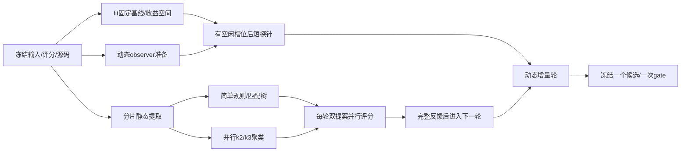

# 快速寻找相位选择特征的计划

日期：2026-11-04，America/New_York。

目标：复用TA已有false/true wall time，尽快判断哪些廉价结构或动作前统计含有可复用的相位选择信息。先交付有效/无效候选及其边界，不预设一定能找到正结果。

本文件冻结执行方法，不是运行结果。旧六类T60研究、既有CaDiCaL RICL提案和在途队列各保留原身份。本计划不重写它们的结果或协议，不启动新的完整SAT耗时矩阵。用户最新明确允许为Glue/decision level在服务器运行短探针；这项有限授权补充此前“不单独重跑SAT实例”的要求。用户随后明确授权agent并行、计算节点并行、实际执行、设置goal和问题邮件通知，故并行实现开始，不再仅停留于计划。

## 要回答的两个问题

|问题|最少需要的证据|对应阶段|
|---|---|---|
|C1：少量输入结构能否预测TA两种相位的相对成本？|开发留出上优于fit选定固定相位；收益、覆盖、误选损失可解释，且优于或至少竞争于普通小树|B1–B3、B5|
|C2：极短Glue/level观测是否提供静态特征以外的信息？|完全相同父题、划分、模型容量下，静态+动态优于静态；观测开销及缺失保留|B4、B5|

主要需要排除的解释：收益仅来自永远选较强相位、少数异常题、反复看feedback调参、提前看到终局统计，或没有支付特征成本。聚类与LLM是候选发现工具，其存在本身不构成贡献。

## 数据和范围

- 结果来源：用户附件 `/Users/expexp/.codex/attachments/d72b682d-d232-4410-838a-6fbcb063bbc5/data.xlsx`，SHA256 `51dec2fdf3512571aaaac92d65915a39cd879a6b63083fd8b90a846ce90c6158`，sheet data、A1:J801。400实例、800条false/true运行；213题双超时、187题至少一个方向解出。这些是全附件描述，不是开发明确赢家数。
- 原`ile`列只作关联标识。模型/聚类/提案不使用family、应用/生成器、文件名、路径、URI、年份、作者、hash或SAT真值。hash仅作关联、固定顺序、等价组和去重。
- 复用已冻结的180 fit、60 feedback、60 gate；附件中另100个开发区之外实例排除开发。整个5355最终候选命名空间继续封存。本计划不为最终测试另造标签。
- 既有资源资格允许144 fit、48 feedback、51 gate提取完整特征；按原资源排除清单保留原因。主离线评估保留所有180/60/60题，资格不满足或提取失败时回退fit选定固定相位，不把缺特征病例删出成本分母。报告完整人口与特征可用子集，区分总题数、可用特征数及明确方向标签数。
- 复用当前版本CNF特征缓存，绑定输入SHA/提取器SHA/单位与定义；缺失时只解析CNF补提取。原始计时不重新运行，也不截成60秒。
- 表中false/true仍按原polarity_mode命名。原MiniSAT版本/命令未明确，不先把标签断言为绝对赋值F−/F+，也不把它们替换成CaDiCaL的D/F±或I−成本。
- 数据及旧结果已被观察；fit/feedback是探索，gate称开发留出，不冒称全新独立确认。

## 固定评分和对照

### 成本与未知标签

离线主评分约定T=5000秒：原表报告SAT/UNSAT时用其wall_time_s，TIMEOUT记2T=10000秒。T5000是本分析的预设封顶计分约定，源记录及约5000秒截断支持这一选择，但缺少原命令时不冒称已认证TA真实CPU/墙钟限制。成功状态但wall>T的个案单列，不悄悄重标。该定义在首次新拟合前冻结。

单方向超时给出方向/下界，双超时保持未知，不编造真实速度比。近似平局不硬造分类标签；辅助clear定义沿用至少 `max(0.02秒, 较快时间×10%)` 的差距，单超时使用可证明下界。训练目标是全部成本之和，accuracy仅作辅助。

两类对照足够：

1. always-false、always-true；只在fit选出最佳固定相位，随后冻结。训练叶无支持、缺特征或有歧义时回退该固定相位。
2. 普通成本敏感单阈值/浅树。与每个实际提案匹配深度、最多两个不同数值特征、训练阈值网格和叶支持，避免把LLM提出规则误当成优势来源。

阈值只取fit的1/8至7/8七个分位，最多深度2、每叶至少12个不同父实例，允许至多两项数值特征；不因feedback好坏扩展网格。树和动作直接最小化成本。若当前全项目上位约束更严格，采用更严格限制。

报告：相对最佳固定的总PAR2变化、相对同容量小树的变化、solved、clear覆盖/精度、每题成本差、最坏误选、收益集中度、全部缺失/失败/双超时。等价组为重采样单位，2000次配对bootstrap；重复探针不增加独立n，不使用family分组。

### 特征成本

TA硬件wall time与本地/服务器提取CPU不是同一标尺，不直接相加并包装成端到端部署收益。分别报告：免费特征下的选择收益上限、本地实测提取/探针CPU与墙钟、TA时间尺度下的盈亏平衡开销。若无校准，只能称离线选择信号，不能声称已经改善TA硬件上的净运行时间。

## B1：先做静态特征与收益空间

**目的**：判断问题有没有可利用空间，测试长度、符号与连接结构的低复杂度规则。

第一批固定10项，全部已有定义/提取代码：

|组|数值|
|---|---|
|长度|s_mean_length、s_length_std、s_binary_fraction、s_long_fraction（长度≥5）|
|符号|s_positive_fraction、s_mean_polarity_imbalance|
|树状|g_cycle_excess_per_incidence、g_leaf_variable_fraction、g_largest_component_fraction|
|门代理|g_gate_motif_fraction；须同时记录g_gate_motifs_exact可用性|

仅当既有缺失语义清楚时加入已实现的Horn/anti-Horn、短子句加权符号作为后续有限提案；不一次扩成大特征库。完整DAG深度/共享目前没有完整实现，第一版用局部门代理，不能将其称为已恢复全局DAG。

先只在fit计算免费oracle相对最佳固定的收益空间及有效标签覆盖。若oracle改善≤2%，则该fit面板本身没有足够空间支持后述2%收益门槛；把它作为预算筛选理由，保存有限负结果，不继续花服务器时间追求这个门槛。这不证明未见feedback/gate也无空间，更不证明特征普遍无效。若明确标签不足，只报告成本分析和样本不足。

正式顺序：长度/符号一项简单规则与图/门一项简单规则；保留正负方向，不强制“长必选false”。训练与拟合用fit五折、等价组不跨折；feedback只用于既定候选的完整评价和后续有限反馈。

准备齐缓存/CNF后的时间目标10–20分钟。补提取每题最多2CPU秒、8秒墙钟；超限留记录并回退，提取器原内存上限按现有准备契约保留，不能为了8并发造成内存过量。

## B2：聚类发现结构区域

**目的**：发现全局单阈值掩盖的交互，给后续提案提供数值画像。

- 仅在完整可用的fit数值向量上拟合。长度均值/标准差先log1p，随后各维用fit中位数/IQR缩放；零IQR用1。源码冻结前选用更保守的缺失契约：缺任一聚类维度返回未分簇，不填补成一个实测结构；完整评价人口仍保留并按固定相位回退。反馈和gate仅使用已冻结变换。
- 只尝试k=2与k=3的K-means，固定10个初始化种子。簇不使用相位赢家、运行时间、SAT/UNSAT或family来构建。
- 汇总fit各簇的特征分位、动作成本、超时比例、方向支持与最坏误选，检查不同初始化下偏好是否反复变向。少于12个fit父题或缺乏方向证据的簇不赋予可靠偏好。
- 聚类首先是诊断和反馈压缩，最终提炼成白名单数值浅规则。若要直接用簇路由，必须另存变换/中心、缺失行为、计算成本并按同一留出流程评价；不能把好看的散点图当选择器。

时间目标5–10分钟；不为了轮廓系数更好而扩大k网格。聚类参考ISAC的实例特征分组思路，不假定本数据会获益。[ISAC原文](https://ai.dmi.unibas.ch/research/reading_group/kadioglu-et-al-ecai2010.pdf)

## B3：反馈驱动的in-context learning

**目的**：利用已有反例改进小规则，并检验这种提案过程是否超过普通小树。

最多4轮，每轮最多2个预先提交的JSON提案；计入全项目既定8轮总额度的剩余配额，不因改分支而重置额度。旧round2未评分提案原样保留，不补写reward。

建议顺序：TA-R1长度/符号与图/门；TA-R2使用聚类画像提出交互；TA-R3根据真实误选损失修正；TA-R4仅在仍有新增信息时加入动态量或最后改进。每次读取新feedback前冻结提案、输入集合、源码和SHA。

每轮只在fit拟合阈值/叶动作，完整feedback计分。episode保存：规则/hash、成本相对固定策略和同容量树的变化、最大损失及收益、支持题数、失败/缺失、下一版修改理由。上下文只包含允许开发数据的数值画像与反例，不提供family或可识别的题目名称。负reward永久保留。

reward以相对fit选定最佳固定相位的PAR2下降定义；特征费另报口径。至少完成3轮（若B1已证明收益空间不足则不强行完成）；第3轮后，连续两轮没有至少0.5个百分点的反馈改善时停止；最多4轮。模型权重不更新；不能声称已训练Algorithm Distillation或有未实际执行的第二LLM对照。这里更接近语言反馈经验记忆。[Reflexion](https://arxiv.org/abs/2303.11366)、[Algorithm Distillation](https://arxiv.org/abs/2210.14215)

在缓存齐备时，B1–B3的首份候选报告目标30–60分钟；计时不是保证，下载和数据缺失另报。重复使用feedback的区间为探索性，最终不能拿最好的反馈数字当泛化证明。

## B4：服务器短探针补Glue/decision level

**目的**：以很少的新计算检验动作前动态量是否提高对TA相位偏好的预测。

用户授权仅用于采集这些必要动态特征。先复用输入/solver/观测点/定义与成本身份兼容的合法动作前记录；不使用TA表的终局冲突/决策计数作为输入。无兼容记录才补采。

### 固定采集范围

- 第一块用既有固定顺序前24个合格fit＋前16个合格feedback，共40题，仅检查可观测覆盖和正式运行有效性，不评分部分feedback。
- 每题只运行一个固定CaDiCaL D前缀（phase1、forcephase0），seed0，总进程预算2CPU秒（包含解析），10秒墙钟看门狗。观察点为跨过1000冲突后的第一个自然重启；达到预算仍未到点则动态特征缺失，成本保留。
- 先用现有no-op合格遥测与实际CPU预算helper；具体CLI、observer版本和行级schema必须在对应采集实现协议中提交。不能拿整数墙钟参数冒充2CPU秒。无需运行false/true的完整终局比较。
- 最多8任务，按真实空闲核、1.5GiB/任务、1GiB临时证明、12GiB磁盘底线执行。已有健康队列的资源不能重复占用；先继承其完成/释放的槽位，不启动第二个同实验owner。
- early-solved和资源/格式/验证失败保留；原题答案不作输入。若采纳早解结果，须验证并计费；没有验证的答案不冒充成功标签。主标签仍是TA旧运行。

### 仅6个候选动态量

glue均值、raw glue低值比例、fast/slow glue比、最小化后学习子句均长、实际回退目标层均值、平均回退跨度。初始/最小化阶段及CaDiCaL `levels−1` glue口径绑定源码，不能把raw阈值直接等同于经典Glucose LBD2。低学习事件数（少于20个）或无定义分母标为不可用，策略回退静态。

若40题中至少20题有完整主动态向量，且无未解决的执行错误，可沿既有合格hash顺序补至全部144fit＋48feedback；第一块记录逐条复用。覆盖不足则记录此次短探针证据不足，不自动扩成5/60/600秒搜索。

对相同全部180fit/60feedback人口比较静态与静态+动态；资格不满足、未到点或缺失均保留并回退静态策略。动态加入后仍最多2特征/深度2，与同容量小树比较，不能从两个不同题目子集制造“增量”。

最多192×2=384CPU秒的主探针预算，理想8并发约48秒只是求解工作量。准备、解析、序列化、必要工程和早解验证另计；整个动态采集阶段先分配最多1CPU核时，并受全项目100CPU核时限制，启动前去重更新账本、预留在途成本。若余量不足则减少并发/按块停止并报告覆盖不足，不省略校验。

服务空闲且遥测实现可用后，目标额外15–30分钟；如需修改observer，先单列实现时间，不将其包装成已运行。只做必要的实现性质测试，不另开audit/dryrun。

**解释边界**：这是“CaDiCaL早期探针预测TA MiniSAT旧标签”的跨求解器辅助特征实验。它不是同状态相位切换的反事实实验，也不能证明在CaDiCaL切换后会更快。若要声称后者，需要另一个明确授权、单独冻结的延续性能实验，本计划不启动它。

## B5：冻结一个候选，一次开发留出

不同时将多个候选送入gate。B1–B4结束后冻结一个规则、最佳固定相位、最强匹配容量浅树、提取/探针契约与缺失策略。

进入gate的筛选条件：feedback相对最佳固定相位PAR2点改善≥2%，至少12个不同feedback父题触发非默认选择，且有至少20个可判方向的feedback题用于辅助诊断；收益不能只来自单题。具体收益集中度和逐题损失全部列出。达不到则交付探索候选或证据不足，不打开gate。

一次gate对原60题全量离线计分；资源排除/提取失败者回退。若最终候选需要动态量，只在规则冻结后按同一2CPU秒契约采集合格gate的动作前观测，其结果和成本不回流提案上下文。gate最多51×2CPU秒主探针，另按同一总账记准备/验证费用。其他gate特征也不用于重新拟合。

本TA离线分支称为“有开发留出支持的结构选择信号”的条件：相对冻结最佳固定相位PAR2至少改善2%，等价组配对95%区间下界>0，覆盖和最坏误选透明。普通浅树也达到这个条件时，同样可以发现有用结构特征。ICL的额外价值必须另看相对匹配浅树的配对增量，未胜出就不声称ICL优越。若动态的选择收益不足盈亏平衡开销，不称净收益。

这里的结构信号分层不替代既有CaDiCaL部署晋级标准；要声称超过最强简单/静态方案，仍须满足原来相对两者至少2%及区间方向支持的要求。原60gate仍只有一次机会：若本分支实际打开TA gate评价，即永久记录已用，不能在后续CaDiCaL分支又将同组当成未使用留出。当前只是预留，未打开。

即使通过，也仅说明原TA数据和既定划分上的选择信号。没有新硬件端到端部署或新测试测量，不声称跨solver、跨新分布或已部署成功。

## 执行顺序、时间和停止点

### 并行修订：以依赖图执行

2026-11-04用户明确要求agent并行和node并行，随后要求立即推进并设置goal。原串行时间表仅用于工作分解，实际关键路径按并发任务的最大耗时计算。细则见 [静态/聚类分工](PARALLEL_STATIC_CLUSTER.md)、[节点调度](PARALLEL_NODES.md)、[ICL屏障](PARALLEL_LEARNING.md)。

root唯一拥有数据清单、目标状态、预算、完整反馈和gate。子agent A实现数据/静态缓存与公共分片；B实现成本模型/聚类；C实现节点worker/短探针准备。源代码冻结后，静态提取、fit固定对照与探针准备可重叠；完整fit特征后，简单规则、k2、k3并行。每轮两个提案各占一个名额并行，完整反馈汇总后才能进入下一轮。动态采集不必等待静态ICL全部轮次，但必须满足fit选择空间门槛、观测资格和实际资源。

node指计算节点，不是Node.js线程。现有remote若满载则不叠加worker；本机离线统计仍可推进。新增电脑需明确接入/资源，先准备只含公共CNF任务与提取器的独立分片包，不包含TA性能、gate/test、凭据。已提供的两SSH入口与当前remote记录一致，不能计为两台新增机器。中央manifest唯一claim，完成项SHA复用、失联标UNKNOWN不自动重提。所有agent/node共享同一提案和CPU总额。

并行时间目标：从允许的输入/源码冻结及可用缓存开始，先在20–40分钟产出一份静态结果，静态迭代与动态采集重叠后的完整快速反馈以45–90分钟为规划目标；下载、节点接入、既有队列占用、observer工程和失败恢复另报。该缩短值是调度目标，不是已测加速或找到正特征的保证。

|顺序|工作|时间目标|计算|停止/继续|
|---|---|---|---|---|
|M0|源身份、角色、删失约定与特征缓存关联；并入正式执行|5–10分钟|不运行solver|身份冲突/结果矛盾先修正输入，不开始拟合|
|M1|B1静态特征与简单对照|10–20分钟|补提取最多2CPU秒/题；复用TA标签|fit免费oracle≤2%或标签不足则限定负结果|
|M2|B2聚类＋B3有限ICL|15–30分钟|本地统计/最多4轮×2提案|无稳定收益就停止扩参，保留全部失败|
|M3|B4动态40题，覆盖合格则补全192|空闲槽位后15–30分钟，工程另计|每题一个2CPU秒前缀；阶段≤1CPUh|少于一半可用则不延长探针时间|
|M4|B5冻结/一次gate/报告|10–20分钟＋必要特征采集|静态离线；动态gate主探针≤102CPU秒|只确认一个候选，gate不回流|

主交付：第一份静态候选表约30–60分钟（从缓存/CNF齐备起）；加入动态及最终开发留出目标1–2小时，排队、传输、observer工程和资源故障另报。找到有用特征不是时间承诺。

## 输出及简洁性

必须交付：逐题输入角色与成本/删失、特征可用性、10项特征说明、两种聚类画像、全部ICL提案/负反馈、一个最终规则或明确负结果、静态/动态配对对照、成本账本。图表以特征与相位偏好的分布、逐题损失和覆盖为主，避免只展示赢家子集。

必要首轮只含B1–B3；B4依据选择空间和遥测资格进行，B5依据候选资格进行。全局DAG恢复、更大的聚类网格、复杂RL权重训练、GPU求解、新完整SAT终局矩阵和全体最终测试均不属于本快速计划。

## 启动与连续性

本计划提交Git后才执行对应正式评分；每个程序/采集实现还要记录源码SHA和执行身份。保持一实验一owner、单位checkpoint、兼容记录复用，不重复健康worker。用户已明确授权本聊天子agent协作及问题邮件；邮件沿用此前确认的ccmuagent@gmail.com，仅通知阻碍、运行失败或需用户处理的问题。仍不得向其他聊天发消息或写入凭据。记录失败和负结果。

当前goal已创建为active，进入并行实现与源码冻结，随后执行正式离线分析和合格短探针。当前正在运行的CaDiCaL队列不由本计划重复提交、静默取消或改写。
